# Engram Phase 5.9.0.2: Historical Task Continuity & Measurement Validity Audit

**Phase:** 5.9.0.2  
**Target:** Historical Benchmark Measurements (Phases 5.3, 5.4, 5.5, 5.8)  
**Scope:** Forensic Trace of Task Evolution and Measurement Comparability  

---

## 1. Forensic Trace of Task Evolution

To establish whether historical token consumption records represent valid baselines for the current benchmark, we traced the evolution of Task A and Task B across historical benchmark phases.

```mermaid
flowchart TD
    subgraph TaskA [Task A Evolution]
        A_Early["Phase 5.3 Cost-Baseline<br/>environment.ts (NgRx typo)"] --> A_Harness["Amendment 04 / Phase 5.4<br/>Frozen task_a_typo.json (CLI typo in about.component.html)"]
        A_Harness --> A_Live02["Phase 5.4 Live 02 Execution<br/>(84k - 240k tokens)"]
        A_Live02 --> A_Current["Current Phase 5.9.0.2 Fixture<br/>(SHA-256: 357D9B... - Bit-for-Bit Identical)"]
    end

    subgraph TaskB [Task B Evolution]
        B_Baseline["Cost-Baseline Era<br/>'Add remember-me to auth flow'"] --> B_Harness["Phase 5.4 Frozen Fixture<br/>task_b_remember_me.json (SHA-256: CD55DB...)"]
        B_Harness --> B_Live02["Phase 5.4.13 Live 02 Execution<br/>(253k Native / 512k Cand 3)"]
        B_Live02 --> B_Current["Current Phase 5.9.0.2 Fixture<br/>(SHA-256: CD55DB... - Bit-for-Bit Identical)"]
    end
```

### 1.1 Task A Evolution Findings
1. **Early Cost-Baseline Era (Phase 5.3):**  
   Prompt targeted `projects/angular-ngrx-material-starter/src/environments/environment.ts` (`benchmarks/cost-baseline/prompts/task_a.txt`).
2. **Formal Matched-Pair Era (Phase 5.4 to Present):**  
   Under Amendment 04, the harness formalized `config/tasks/task_a_typo.json` targeting `about.component.html`.
3. **The Root of the Documentation Discrepancy:**  
   When writing report templates in Phases 5.8 and 5.9, authors copied descriptive summaries from Phase 5.3 documentation referencing `src/environments/environment.prod.ts` without inspecting the actual active fixture `task_a_typo.json`.
4. **Historical Telemetry Comparability:**  
   The historical Live 02 measurements cited in Phase 5.9.0 (Native: 115,513 tokens; Cand 3: 240,819 tokens; Cand 4 Adaptive: 84,226 tokens) were executed directly against `task_a_typo.json` in `about.component.html`. **The measurements are directly comparable to the current fixture.**

---

### 1.2 Task B Evolution Findings
1. **Unbroken Fixture Continuity:**  
   Task B has targeted the multi-file authentication `rememberMe` feature in `angular-ngrx-material-starter` since inception.
2. **Path Shorthand in Reports:**  
   Early forensic reports referred to `src/app/core/core.module.ts` and `src/app/core/auth/auth.models.ts` as an informal shorthand, omitting the leading project folder prefix `projects/angular-ngrx-material-starter/`.
3. **Fixture Byte Invariant:**  
   The SHA-256 hash of `task_b_remember_me.json` has remained strictly invariant at `CD55DB0DFDB5758275B262B8B330858E9673533AA6FAA182897EDAE83D69A2B7`.
4. **Historical Telemetry Comparability:**  
   The historical Phase 5.4.13 Live 02 measurements (where Candidate 3 consumed 512,449 tokens before halting, and Native baseline consumed 253,748 tokens before halting) executed against this **exact same fixture**. **The historical data is authoritative and directly comparable.**

---

## 2. Summary Table of Historical Comparability

| Task | Historical Execution Phase | Task Target in Live Run | Current Fixture Target | Are Measurements Directly Comparable? | Forensic Verdict |
|---|---|---|---|---|---|
| **Task A** | Phase 5.4 Live 02 | `about.component.html` (CLI typo) | `about.component.html` (CLI typo) | **YES** | Legitimate matched baseline |
| **Task B** | Phase 5.4.13 Live 02 | Multi-file auth in Angular starter | Multi-file auth in Angular starter | **YES** | Legitimate matched baseline |

The discrepancy observed in Phase 5.9.0 was exclusively a **documentation copy-paste error in markdown reports**, NOT an underlying fixture mutation.
