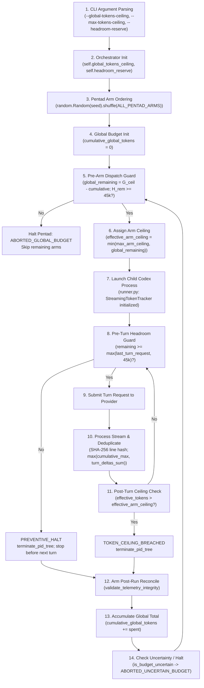

# Engram Phase 5.9.0.3: Token Accounting Lifecycle & Architecture Specification

**Phase:** 5.9.0.3  
**Target Files:** `benchmarks/matched-pair-harness/src/orchestrator.py`, `runner.py`, `telemetry.py`  
**Execution Mode:** Strictly Offline Source-Code Audit  

---

## 1. End-to-End Token Accounting Flow

We traced the complete token budget lifecycle across 14 distinct stages from CLI invocation to disk serialization:

---

## 2. Definitive Inventory of Budget Counters and Accounting Layers

| Budget Variable / Counter | Scope | Unit | Cumulative or Delta? | Includes Cached Input? | Includes Completion Output? | Includes Reasoning Tokens? | Includes Tool Invocations? | Includes Provider Retries? | Includes Incomplete Requests? |
|---|---|---|---|---|---|---|---|---|---|
| `global_tokens_ceiling` | Block / Invocation | Tokens | Static ceiling | N/A | N/A | N/A | N/A | N/A | N/A |
| `max_tokens_ceiling` | Arm | Tokens | Static ceiling | N/A | N/A | N/A | N/A | N/A | N/A |
| `headroom_reserve` | Turn / Arm | Tokens | Static threshold | N/A | N/A | N/A | N/A | N/A | N/A |
| `effective_arm_ceiling` | Single Arm Execution | Tokens | Dynamic limit | N/A | N/A | N/A | N/A | N/A | N/A |
| `thread_cumulative_max` | Single Arm Session | Tokens | Cumulative monotonic | **YES** | **YES** | **YES (Sub-metric)**| **YES** | **YES** | If emitted prior to crash |
| `turn_deltas_sum` | Single Arm Session | Tokens | Deduplicated sum | **YES** | **YES** | **YES (Sub-metric)**| **YES** | **YES** | Only completed turns |
| `effective_tokens` | Single Arm Session | Tokens | $\max(\text{cum}, \text{deltas})$ | **YES** | **YES** | **YES** | **YES** | **YES** | Authoritative local count |
| `cumulative_global_tokens` | Invocation (5 Arms) | Tokens | Sum of arm spent | **YES** | **YES** | **YES** | **YES** | **YES** | Verified arm usage |

---

## 3. Disentangling Token Accounting Terminologies

To eliminate cross-layer ambiguities:
1. **Provider-Reported Usage:** The literal integers parsed from `token_usage_record.thread_token_usage` (`input_tokens`, `output_tokens`, `cached_input_tokens`, `reasoning_output_tokens`).
2. **Locally Estimated Turn Demand:** Calculated in `StreamingTokenTracker.estimate_next_request_tokens()` as:
   $$E_{\text{est}} = \max(\text{last\_turn\_request\_tokens}, 45,000)$$
3. **Locally Enforced Budget Counters:** `effective_arm_ceiling` in `runner.py` and `global_tokens_ceiling` in `orchestrator.py`.
4. **Post-Cancellation In-Flight Residual:** Tokens generated remotely on provider GPUs after local process termination (`taskkill`) before network socket teardown completes remotely.
