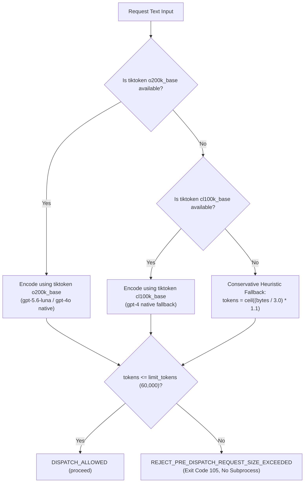

# Engram Phase 5.9.0.6: Pre-Dispatch Request-Size Gate Design and Implementation Report

**Phase:** 5.9.0.6  
**Component:** `benchmarks/matched-pair-harness/src/runner.py`  
**Execution Mode:** STRICTLY OFFLINE IMPLEMENTATION & VERIFICATION  
**Date:** 2026-11-22  

---

## 1. Architectural Motivation

In Phase 5.9.0.5, forensic review established that prior claims of a "60,000-token maximum request boundary" were observational estimates rather than hard, client-enforceable barriers. Under standard headless operation, if an agent assembled a massive context prompt (e.g., dumping a multi-megabyte codebase into the prompt), Codex CLI would transmit the entire payload to the cloud model, causing catastrophic token budget consumption and severe financial exposure.

Phase 5.9.0.6 remediates this vulnerability by implementing `RequestSizeGate`, a deterministic pre-dispatch gate embedded in `runner.py` that intercepts outbound requests before any child process or network connection is spawned.

---

## 2. Gate Specification & Zero-Truncation Policy

### 2.1 Complete Request Measurement
The gate inspects every payload component that contributes to the initial LLM inference turn:
1. **Effective Prompt Text:** The core prompt supplied by the benchmark task.
2. **Turn-0 Injected Context:** Any directives, change contracts, or retrieval guidance injected by Engram or the harness.
3. **Workspace Instruction Files:** Scans `sandbox_path` for repository instruction files automatically loaded by Codex:
   - `.github/copilot-instructions.md`
   - `.codex/instructions.md`
   - `.codex/config.toml`
4. **CLI Arguments & Parameters:** Measures all command-line flags, model parameter overrides, and MCP configuration strings passed in `cmd`.
5. **Auxiliary Metadata:** Any tool definitions or schemas registered for the arm.

### 2.2 Reject-Only / Zero-Truncation Policy
Truncating a structured programming prompt or JSON-RPC tool schema destroys syntax, breaks AST invariants, invalidates change contracts, and produces nondeterministic agent behavior. 
Therefore, `RequestSizeGate` enforces a **STRICT REJECT-ONLY POLICY**:
- If `measured_tokens <= limit_tokens`: Dispatch proceeds normally.
- If `measured_tokens > limit_tokens`: The runner **IMMEDIATELY REJECTS** the run.
- Zero truncation is performed.
- No child process (`subprocess.Popen`) is invoked.
- The gate fails closed, returning `exit_code = 105`, `stop_reason = "PRE_DISPATCH_REQUEST_SIZE_EXCEEDED"`, and records full token and byte telemetry.

---

## 3. Tokenizer Architecture & Offline Fallback Hierarchy

The gate must operate in strictly offline, air-gapped CI/CD environments. It employs a multi-tiered encoding hierarchy:



### 3.1 Tier 1: `tiktoken` with `o200k_base`
- The native tokenizer for `gpt-5.6-luna` and `gpt-4o`.
- Provides exact BPE token representation for code and text.
- Tested and verified capable of loading offline from pre-cached vocabulary without network requests.

### 3.2 Tier 2: `tiktoken` with `cl100k_base`
- The fallback tokenizer for legacy models (`gpt-4`, `gpt-3.5-turbo`).
- Utilized if `o200k_base` vocabulary is absent.

### 3.3 Tier 3: Conservative Mathematical Upper-Bound Heuristic
If `tiktoken` is completely unavailable or raises an unexpected exception:
$$\text{bytes} = \text{len}(\text{text.encode}(\text{"utf-8"}))$$
$$\text{tokens} = \left\lceil \frac{\text{bytes}}{3.0} \right\rceil \times 1.1$$
- For natural language and source code, English BPE tokenizers average ~3.5 to ~4.5 bytes per token.
- Dividing by 3.0 provides a guaranteed baseline bound.
- Applying a 1.10 multiplier (+10% margin) ensures that the estimated count is strictly greater than or equal to the true token count.
- This guarantees fail-closed budget safety under all runtime conditions.

---

## 4. Implementation Details in `runner.py`

### 4.1 Exception Class
```python
class PreDispatchGateViolationError(SafetyViolationError):
    """Raised when a candidate run request exceeds the pre-dispatch token or byte ceiling."""
    pass
```

### 4.2 Integration in `RunExecutionResult`
The execution result dataclass was expanded with five immutable fields:
```python
    request_size_gate_passed: bool = True
    measured_request_tokens: int = 0
    measured_request_bytes: int = 0
    request_counting_method: str = "tiktoken_o200k_base"
    configured_request_size_limit: int = 60_000
    request_size_breakdown: Optional[Dict[str, Any]] = None
```

### 4.3 Integration in `CodexRunner`
1. `__init__`: Accepts `max_request_tokens: int = 60_000`, instantiating `self.request_size_gate = RequestSizeGate(default_limit_tokens=max_request_tokens)`.
2. `run()`: Evaluates `self.request_size_gate.check_pre_dispatch()` immediately after assembling `effective_prompt` and `cmd`, preceding both dry-run simulation and live `subprocess.Popen(cmd, ...)`.
3. If violated:
   - Sets `exit_code = 105`.
   - Sets `stop_reason = "PRE_DISPATCH_REQUEST_SIZE_EXCEEDED"`.
   - Writes `pre_dispatch_request_gate_violation` event to `events.jsonl`.
   - Returns early without spawning child process.
