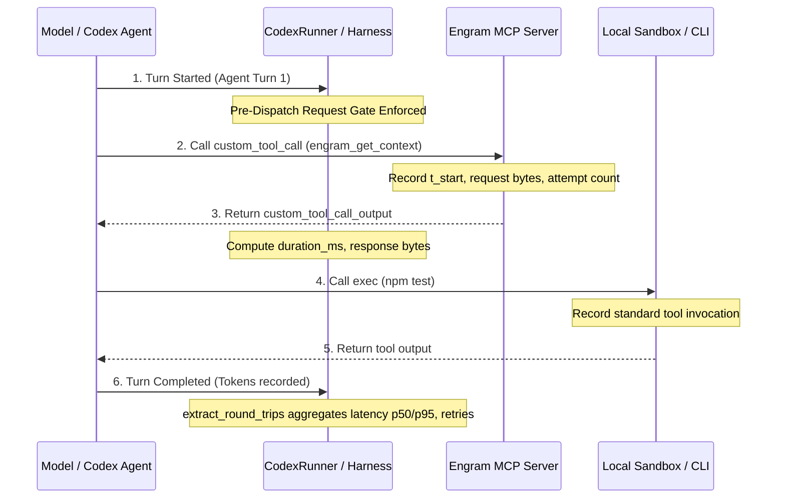

# Engram Phase 5.9.0.6: Round-Trip Telemetry Implementation Report

**Phase:** 5.9.0.6  
**Component:** `benchmarks/matched-pair-harness/src/telemetry.py` & `src/orchestrator.py`  
**Execution Mode:** STRICTLY OFFLINE IMPLEMENTATION & VERIFICATION  
**Date:** 2026-11-22  

---

## 1. Architectural Overview

The round-trip telemetry engine reconstructs the conversational and tool execution lifecycle from JSONL event streams. It establishes a complete, auditable timeline of interactions between the LLM agent, MCP servers, and local execution environments.



---

## 2. Core Telemetry Primitives in `telemetry.py`

### 2.1 Distinction of Metrics
1. **Agent Turns (`total_agent_turns`):** Represents the discrete conversational iterations where the model received input and generated actions or completions (mapped to `turn.completed` events).
2. **Tool Round Trips (`total_round_trips`):** Every matched invocation pair where the agent requested a tool call and received a tool result.
3. **Engram MCP Calls (`engram_mcp_calls`):** Specifically filters for tools provided by the Engram MCP server (`engram_get_context`, `engram_inspect_symbol`, `engram_why`, `engram_preflight`, `engram_postflight`).
4. **Standard Tool Calls (`standard_tool_calls`):** Filesystem, shell, and editor commands executed directly by the agent (`exec`, `bash`, `read_file`, `write_file`, `rg`).
5. **Tool Execution Latency:** Computed as:
   $$\Delta t = t_{\text{output}} - t_{\text{call}}$$
   Reported in milliseconds with p50 (median), p95 (95th percentile), mean, minimum, and maximum.
6. **Payload Bytes:** Measures exact serialized UTF-8 bytes of tool inputs (`request_bytes`) and outputs (`response_bytes`).
7. **Logical Operations vs Physical Attempts (Retries):** Tracks tool invocations by `(tool_name, arguments_hash)`. If the exact same call is executed again within the same run, `is_retry = True` and `attempt_number` increments.

---

## 3. Extraction Engine: `TelemetryParser.extract_round_trips()`

The parser inspects three primary JSONL streaming schemas emitted by Codex:
1. `response_item` (`custom_tool_call` and `custom_tool_call_output`):
   - Maps requests and outputs via `call_id`.
   - Computes duration from ISO-8601 timestamps.
2. `item.started` and `item.completed`:
   - Correlates tool execution initiation and termination.
3. `event_msg` (`item_completed`):
   - Handles wrapped telemetry records emitted by certain versions of the Codex runner.

### 3.1 Statistical Aggregation Algorithm
```python
latencies = [e.duration_ms for e in completed_events]
if latencies:
    mean_lat = round(sum(latencies) / len(latencies), 2)
    sorted_lat = sorted(latencies)
    median_lat = round(sorted_lat[len(sorted_lat) // 2], 2)
    p95_idx = min(len(sorted_lat) - 1, int(math.ceil(0.95 * len(sorted_lat))) - 1)
    p95_lat = round(sorted_lat[p95_idx], 2)
```

---

## 4. Orchestrator Integration: `RoundTripComparison`

In `orchestrator.py`, `compute_comparative_analysis` now automatically evaluates round trip benefits when comparing treatment arms against baseline arms:
```python
rt_comp = {
    "baseline_round_trips": ctrl_rts,
    "treatment_round_trips": treat_rts,
    "round_trips_delta": ctrl_rts - treat_rts,
    "round_trips_reduction_pct": round(((ctrl_rts - treat_rts) / ctrl_rts) * 100.0, 2),
    "baseline_agent_turns": ctrl_turns,
    "treatment_agent_turns": treat_turns,
    "agent_turns_reduction_pct": round(((ctrl_turns - treat_turns) / ctrl_turns) * 100.0, 2),
    "treatment_engram_mcp_calls": treat_rt.get("engram_mcp_calls", 0),
    "baseline_p50_latency_ms": ctrl_rt.get("latency_median_ms", 0.0),
    "treatment_p50_latency_ms": treat_rt.get("latency_median_ms", 0.0),
    "verdict": "ROUND_TRIPS_REDUCED" if (ctrl_rts > treat_rts) else "ROUND_TRIPS_EQUIVALENT"
}
```
This enables direct, scientific verification of whether Engram reduces agent cognitive cycles and network round trips.
